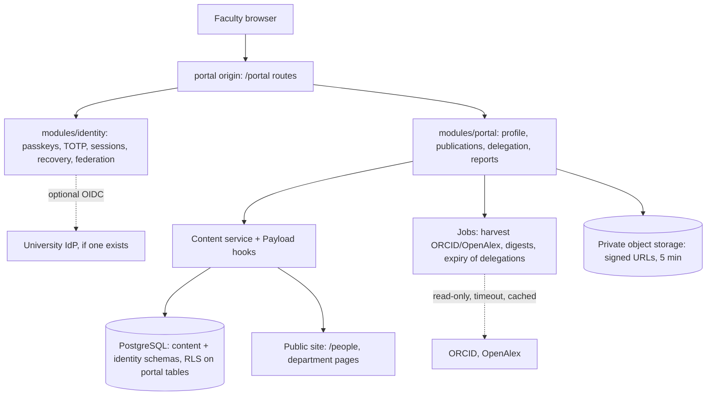
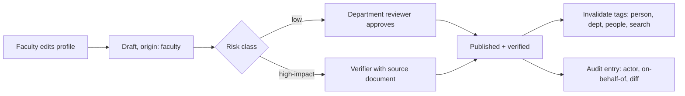

# University of Swat Faculty Portal: Specification v1 (Addendum C)

## Features, security architecture and authentication decision

Date: 9 Nov 2026. Read this together with `Swat_Website_Implementation_Plan_v2.md` and the Addendum of 6 Nov 2026 (templates, migration, 12 challenges). If this document disagrees with either one on anything about the faculty portal, this document wins. Section 14 lists every edit it makes to them.

---

## 0 Start here

### 0.1 The decision in one paragraph

Faculty sign in with **mandatory two-factor authentication, passkey first**. Password-only login does not exist for any portal account. The main method is a passkey: a phone, laptop or security key that unlocks with a fingerprint, face or device PIN, which counts as two factors in one step. The fallback is a long password plus an authenticator-app code (TOTP). SMS codes are not offered. **Single sign-on is a federation option, not a replacement for 2FA.** If the university runs an identity provider for `@uswat.edu.pk` accounts, the portal can trust it, but only when that provider confirms it performed MFA. Section 5 gives the reasoning.

### 0.2 Why a faculty portal at all, and what it must not become

v2 lists "student/faculty login" as a Later-tier non-goal (section 2) and says the Odoo portal at `cms1.uswat.edu.pk` already runs a Faculty system (section 4.5, ADR-0006). This document changes the non-goal, but only in a bounded way:

| Faculty portal does | Faculty portal does not |
|---|---|
| Owns the faculty member's **public academic identity**: profile, research, publications, expertise, teaching portfolio, CV | Store or change grades, attendance, enrolment, fees or salary. Those stay in Odoo and HR |
| Turns one verified record into many outputs: public profile, department page, directory, CV, annual activity report, promotion dossier | Become a second ERP |
| Gives faculty a secure way to publish, with review, instead of emailing a webmaster | Show any student personal data in the competition slice |
| Links into Odoo for teaching administration, through a read-only adapter only after written approval (ADR-0006) | Call Odoo while rendering a page (FF-07) |

The weak spot is that nobody has yet confirmed what Odoo's Faculty module actually does. Open question Q1 (section 13) has to be answered before any Production-tier teaching feature is built, so the portal does not duplicate it.

### 0.3 Honest status

Researched and cited: NIST SP 800-63B-4, OWASP ASVS 5.0, the ORCID and OpenAlex APIs, the Pakistani data-protection position, and the faculty-activity platforms the features are benchmarked against. Not verified: whether the university has a Microsoft 365 or Google Workspace tenant (Q2), what Odoo's Faculty module does (Q1), and which auth library works with Payload 3.93 (spike S-2). Nothing in this document has been built.

### 0.4 Time reality

Today is 9 Nov and the deadline is 17 Nov, so 8 days remain. The Addendum's Must list (section 15) still comes first. This document therefore defines a **thin competition slice (tier C)** that goes ahead only if gate G-FP0 passes on Thu 12 Nov. Everything else is designed now and built after a win. If G-FP0 fails, the portal goes into the submission pack as a specified, threat-modelled roadmap with an auth spike as evidence. That still beats a half-built login screen.

---

## 1 What "world-class" means here

Leading faculty-information systems are built around one idea: capture faculty activity once, then reuse it. Symplectic Elements, for example, gathers research, teaching and service data for internal review and reporting ([Source](https://www.symplectic.co.uk/use-cases/faculty-activity-reporting/)). Interfolio's Faculty Activity Reporting centralises faculty data and lets staff export their activities into CVs, promotion files and annual reviews ([Source](https://www.elsevier.com/products/interfolio/activity-reporting)). Those are commercial US/UK products. What this portal adds is fit to the Pakistani context: HEC journal categories, promotion proformas, circulars that today travel as WhatsApp PDFs, Urdu, and low-bandwidth phones.

A generic portal is a login screen, a profile form and a notice list. This portal is defined by six properties:

| # | Property | Concrete test |
|---|---|---|
| 1 | **Enter once, reuse everywhere** | One publication entry appears on the profile, the CV, the annual report and the department research list with no re-typing |
| 2 | **Harvest, don't type** | Publications are pulled from ORCID and OpenAlex; the faculty member claims or rejects them |
| 3 | **Verified, not self-asserted** | Designation, department and headship come from an Approver-verified source; self-edits to them are impossible |
| 4 | **Delegation without password sharing** | A department assistant can edit a professor's profile under scoped, time-limited, audited rights |
| 5 | **The user can see their own security** | Every faculty member sees their devices, sessions, sign-in history and recovery status, and can revoke any of them |
| 6 | **Leaves cleanly** | On departure, access ends the same day and the public profile becomes "former faculty" with no broken links |

---

## 2 Feature specification

Tiers follow v2: **C** is built for the competition (only if G-FP0 passes), **P** is production, **L** is later.

### 2.1 Identity and profile

| ID | Feature | What it does | Tier |
|---|---|---|---|
| FP-01 | Claim your profile | The 185 imported People records (Addendum section 1) are seeds. A faculty member claims theirs through an invitation sent to the official email held for that record. The claim is confirmed by the department head before the account becomes active (section 5.6) | C |
| FP-02 | Structured profile | Bio (English and Urdu), research interests as controlled keywords plus free tags, education, positions, ORCID iD, Google Scholar link, office location, office hours, photo with consent flag | C |
| FP-03 | Field-level verification | Each field carries a risk class. **Low** (bio, interests, office hours) publishes after a department editor approves. **High-impact** (designation, department, headship, qualifications used for promotion) is never editable by the faculty member and comes from an Approver with a source document | C |
| FP-04 | Live preview | The faculty member sees exactly how the public profile and department card will look before submitting | C |
| FP-05 | Public profile page | `/people/{slug}/` exists only once a profile is claimed and verified. Unclaimed imported records stay as directory entries, matching the Addendum decision that People have no page in the demo | C |
| FP-06 | Privacy controls per field | The faculty member chooses whether email, phone and photo are public, internal or hidden. Defaults are the minimum the university already publishes | C |
| FP-07 | Former faculty state | On departure the profile becomes read-only "former faculty" or "emeritus". URLs stay alive; contact details are removed | P |

### 2.2 Research and publications

| ID | Feature | What it does | Tier |
|---|---|---|---|
| FP-10 | ORCID connection | Reads the public ORCID record by iD. ORCID offers a public API for organisations that are not members ([Source](https://info.orcid.org/what-is-orcid/services/public-api/)). Writing to ORCID (member API) is L | C |
| FP-11 | OpenAlex harvesting | Looks up the author by ORCID and pulls works. OpenAlex treats ORCID as a first-class identifier ([Source](https://help.openalex.org/data/authors/orcid/)), and single-entity lookups are free ([Source](https://help.openalex.org/api/get-single-entities/)) | C |
| FP-12 | Claim or reject queue | Harvested works arrive as candidates. The faculty member claims, rejects ("not me") or marks them as a duplicate. Rejections are remembered so they don't come back. De-duplication is by DOI, then by normalised title plus year | C |
| FP-13 | HEC journal category | Each journal article can carry its HJRS category (W, X, Y), the HEC classification of journals ([Source](https://casrai.org/guides/hec-recognized-journals-hjrs-pakistan)). No public HJRS API was found, so the category is entered once per journal per year by ORIC staff and shared across faculty, with source and `verifiedAt` | P |
| FP-14 | Expertise finder | Public search: "find an expert on hydrology". Results come only from verified keywords and claimed publications, for media, industry and other researchers | P |
| FP-15 | Grants and projects | Project title, funder, role, amount (optional and hidden by default), dates; ORIC verifies | P |
| FP-16 | Research outputs on department pages | A department page shows its recent claimed publications automatically, using the cache tags from Addendum section 5 | P |

### 2.3 Reports that write themselves

| ID | Feature | What it does | Tier |
|---|---|---|---|
| FP-20 | One-click CV | Generates an accessible PDF and a Word file from verified records, in a university template and in an HEC-style template. Shows the date generated and which fields are unverified | C |
| FP-21 | Annual activity report | Pre-filled with the year's publications, teaching, supervision, service and grants. The faculty member adds narrative and evidence; the chair signs off in the workflow | P |
| FP-22 | Promotion dossier builder | Assembles the record against the promotion criteria the university supplies (not invented), with an evidence checklist and missing-item warnings. It never gives an eligibility verdict | P |
| FP-23 | Department and faculty roll-ups | Chairs and deans see aggregate counts (publications by HJRS category, supervision load) for their own scope only | P |

### 2.4 Teaching portfolio (no student data)

| ID | Feature | What it does | Tier |
|---|---|---|---|
| FP-30 | Courses taught | Course code, title, semester, programme. Entered by hand in C; read from Odoo in P after approval (ADR-0006) | C |
| FP-31 | Course outline publishing | Outline, course learning outcomes and reading list publish to the programme page after the department editor approves | P |
| FP-32 | Supervision record | Thesis students by name and title only when the student has consented; otherwise counts only | P |
| FP-33 | Office hours and appointments | Faculty set office hours. A student requests a slot through a public, rate-limited form confirmed by email link. The faculty member sees requests; nothing about the student is stored beyond 30 days | P |

### 2.5 Work and communication

| ID | Feature | What it does | Tier |
|---|---|---|---|
| FP-40 | Internal circulars | Notices for faculty only (not public): searchable, dated, owned by an office, with an archive. Replaces circulars forwarded as PDFs | P |
| FP-41 | Acknowledgement receipts | A circular can require "I have read this". The office sees who has and hasn't acknowledged | P |
| FP-42 | Service requests | NOC, experience certificate and similar requests routed to the owning office with status tracking and a target turnaround. **Only if Odoo or HR does not already do this (Q1)** | P |
| FP-43 | Notification digest | One daily or weekly email digest by default, not one email per event. Security notices are always immediate | C |
| FP-44 | Calendar feed | Personal iCal feed of office hours, deadlines and acknowledged circulars, using a revocable secret URL | L |

### 2.6 Delegation, security centre and data rights

| ID | Feature | What it does | Tier |
|---|---|---|---|
| FP-50 | Delegation | A faculty member grants a named colleague or assistant edit rights over specific sections (for example publications only) for up to 90 days. The delegate acts under their own account; every change records "by X on behalf of Y". The delegate can never change security settings | C |
| FP-51 | Security centre | Lists passkeys and devices (name, created, last used, synced or not), active sessions with approximate location and browser, the last 50 sign-in events, and recovery codes remaining. "Sign out everywhere" and "This wasn't me" buttons; the second one revokes all sessions and alerts the Platform Admin | C |
| FP-52 | Download my data | A JSON and PDF export of everything the portal holds about the faculty member | P |
| FP-53 | Accessibility and language | WCAG 2.2 AA, English and Urdu interface, right-to-left layout, works on a mid-range phone on 3G (same rules as v2 sections 5 and 8) | C |

### 2.7 Explicitly rejected features

| Rejected | Reason |
|---|---|
| Grade entry or attendance | System of record is Odoo; two copies of grades are a data-integrity and legal risk |
| Chat or messaging between faculty and students | Moderation, harassment-reporting and retention duties nobody has agreed to own |
| AI-written bios or publication summaries published automatically | Breaks the "never invent facts" rule. L tier at most, with human approval |
| Public view counts or league tables of faculty | Encourages gaming and creates a privacy issue with no agreed benefit |
| Storing CNIC numbers, salary, bank or medical details | Not needed for any feature; data you don't hold can't leak |

---

## 3 Roles and authorisation

The portal adds four roles. They are separate from the six CMS roles in v2 section 7.3, and a portal account can never hold a CMS admin role through the portal.

| Role | Holder | Can | Cannot |
|---|---|---|---|
| Faculty member | Each teacher | Edit own low-risk fields, claim publications, delegate, generate CV, manage own security | Edit high-impact fields, see others' unpublished data |
| Delegate | Assistant or colleague, per grant | Edit the sections granted, until expiry | Change security, delegate further, submit sign-offs |
| Department reviewer | Department editor (existing Editor role in scope) | Approve low-risk profile changes in their department, see roll-ups for the department | Edit high-impact fields, act outside their department |
| Verifier | HR, Registrar or ORIC staff | Set high-impact fields with source documents; verify HJRS categories and grants | Approve their own profile changes |

Authorisation is attribute-based: owner, department, role, active delegation and record risk class. It is enforced in three places. The service layer is the main check. PostgreSQL row-level security on portal tables is a second line of defence (P). Tests cover every endpoint for cross-account access (IDOR).

---

## 4 Architecture

### 4.1 Placement

| Decision | Choice | Why |
|---|---|---|
| Codebase | Same modular monolith (ADR-0002), new modules `modules/identity` and `modules/portal` | One deploy, one type system, reuse of the content service and cache invalidation |
| Origin | **Separate origin**: `portal.<domain>` in production, a separate demo host for the competition | Host-only cookies cannot leak to the public site; a script bug on the public site cannot use a portal session; separate CSP |
| Identity store | Separate tables in `modules/identity`, not Payload's `users` collection | Keeps CMS admins and faculty in separate realms; a portal compromise does not grant admin |
| How portal edits reach the public site | Through the content service and Payload hooks, never direct SQL | Keeps tag invalidation and the audit log working (Addendum section 6.2, rule 2) |
| Library | Decided in spike S-2. Candidates: Better Auth, which has passkey and two-factor plugins ([Source](https://better-auth.com/docs/plugins/2fa)), or Payload custom auth strategies ([Source](https://payloadcms.com/docs/authentication/custom-strategies)) | No hand-rolled cryptography. The spike proves passkeys, TOTP, recovery codes, server-side sessions and OIDC federation, or the slice is cut |

### 4.2 Publish flow from the portal

This reuses the Addendum's two axes (status and verification) and adds `faculty` to the `origin` values.

---

## 5 Authentication: the decision and its reasoning

### 5.1 Options compared

| Option | Phishing | SIM swap | Usability on phones | Verdict |
|---|---|---|---|---|
| Password only | Fails | n/a | Easy | **Rejected.** The portal can change what the university publicly says about named people |
| Password + SMS code | Fails (codes can be relayed) | Fails | Easy, but depends on network | **Rejected** |
| Password + email code | Fails | n/a | Easy | **Rejected as a factor.** Email is the recovery channel, so a compromised mailbox would hold both factors |
| Password + TOTP app | Partly fails (codes can be relayed live) | Resists | Moderate | **Accepted as fallback** |
| Passkey with user verification | Resists | Resists | Easiest once enrolled | **Primary** |
| Hardware security key | Resists | Resists | Needs a device | **Required for privileged roles in P** |
| University SSO (OIDC) | Depends on the IdP | Depends on the IdP | Easiest if it exists | **Accepted only when the IdP asserts MFA** |

### 5.2 Why passkeys count as two factors and why that matters

NIST's syncable-authenticator appendix to SP 800-63B-4 explains that a WebAuthn key only works with the site it was created for, which stops a fake page from capturing and reusing it. It also says verifiers must request user verification and check the UV flag: if the user was not verified, the authenticator counts as only one factor ([Source](https://pages.nist.gov/800-63-4/sp800-63b/syncable/)). The same appendix allows synced passkeys at AAL2, but not at AAL3, because syncing makes the key exportable ([Source](https://pages.nist.gov/800-63-4/sp800-63b/syncable/)). AAL2 means high confidence that the claimant controls authenticators bound to the account ([Source](https://nvlpubs.nist.gov/nistpubs/SpecialPublications/NIST.SP.800-63B-4.pdf)). **Target: AAL2 for every portal account, phishing-resistant for privileged roles.**

### 5.3 Authentication rules

| ID | Rule | Tier |
|---|---|---|
| AUTH-01 | No account is usable without a second factor. First sign-in from the invitation forces enrolment of a passkey, or a password plus TOTP, before anything else | C |
| AUTH-02 | WebAuthn ceremonies set `userVerification: "required"`; assertions without UV are rejected | C |
| AUTH-03 | Passwords: at least 15 characters, no composition rules, checked against a breached-password blocklist, no forced periodic change. Paste and password managers allowed | C |
| AUTH-04 | TOTP: 6 digits, 30 s step, ±1 step tolerance, each code accepted once, secret encrypted at rest | C |
| AUTH-05 | Ten single-use recovery codes issued at enrolment, stored hashed, regenerating invalidates the old set | C |
| AUTH-06 | At least two authenticators are encouraged (for example phone passkey plus recovery codes); the security centre warns when only one exists | C |
| AUTH-07 | Privileged roles (Verifier, Platform Admin, anyone with roll-up access) must use a passkey or security key; TOTP is not allowed for them | P |
| AUTH-08 | SSO via OIDC is accepted only if the ID token's `amr`/`acr` shows MFA; otherwise the portal asks for its own second factor | P |
| AUTH-09 | Step-up re-authentication (fresh passkey or TOTP within 10 minutes) before: changing authenticators, creating a delegation, downloading data, approving high-impact fields | C |
| AUTH-10 | Sign-in responses do not reveal whether an email exists | C |

**Passkey scope decision (has to be fixed before production).** A passkey is bound to its RP ID, and changing the RP ID later invalidates every enrolled passkey. If the RP ID were the bare `uswat.edu.pk`, any subdomain could request assertions for it, including an outdated or compromised WordPress host. **Use `portal.uswat.edu.pk` as the RP ID.** The competition demo runs on a non-official host (v2 section 9.3), so demo passkeys will be re-enrolled at cutover. That is expected and is written into the cutover runbook.

### 5.4 Sessions

| ID | Rule | Tier |
|---|---|---|
| SES-01 | Server-side sessions in PostgreSQL; the cookie holds only an opaque 256-bit random ID | C |
| SES-02 | Cookie `__Host-portal`, `Secure`, `HttpOnly`, `SameSite=Lax`, `Path=/`, no `Domain` | C |
| SES-03 | Session ID rotates at sign-in, step-up and any role change | C |
| SES-04 | Idle timeout 30 minutes, absolute lifetime 12 hours, "shared computer" option ends at 15 minutes idle [PROPOSED; university IT can adjust] | C |
| SES-05 | Revoking a session, an authenticator or an account takes effect on the next request | C |
| SES-06 | State-changing requests require a CSRF token and a matching `Origin` header | C |

### 5.5 Abuse controls

| ID | Rule | Tier |
|---|---|---|
| ABU-01 | Progressive delay per account and per IP after failed attempts; no permanent lockout, which attackers could use to block staff | C |
| ABU-02 | Alert on impossible travel, sign-in from a new country, or more than 5 failed second-factor attempts | P |
| ABU-03 | Email to the user on every new device, new authenticator, recovery-code use and delegation | C |
| ABU-04 | Rate limits on the public expertise finder and the appointment form; directory emails shown only where the faculty member chose "public" | C / P |

### 5.6 Enrolment and recovery (where most account takeovers actually happen)

| Step | Control |
|---|---|
| Account creation | Only from an imported People record or an HR-provided list. No self-registration |
| Invitation | Single-use link to the official email, valid 72 hours, bound to that record |
| Activation | Department head confirms "this is our faculty member" in the reviewer queue. The account stays inactive until then |
| Lost device with recovery codes | Sign in with a code, enrol a new authenticator, all other sessions revoked, email alert |
| Lost everything | In-person or video identity check by the department head plus the IT Directorate, logged with both names. **24-hour delay** before the new enrolment works, with an email to the old address, so a real owner can stop a fraudulent reset |
| Departure | HR or the Registrar marks the person as left; sessions, passkeys and delegations are revoked the same day; quarterly access review by each chair |

---

## 6 Security architecture beyond login

Target: **OWASP ASVS 5.0 Level 2** for the portal. ASVS 5.0.0 is the current release ([Source](https://asvs.owasp.org/)). v2's SEC-01 referred to ASVS without a version, and section 14 pins it.

### 6.1 Threat model (STRIDE summary)

| Threat | Example | Main control |
|---|---|---|
| Spoofing | Phishing page for the portal | Passkeys (origin-bound), no SMS, security notifications |
| Spoofing | Fraudulent account recovery | 24 h delayed reset, two-person identity check |
| Tampering | Faculty raises own designation to Professor | High-impact fields are not writable by owner; Verifier with source document |
| Tampering | Stored XSS through bio rich text | Allow-listed rich text (no raw HTML), output encoding, strict nonce CSP |
| Repudiation | "I didn't change that" | Append-only audit log with actor, on-behalf-of and diff; hash-chained in P |
| Information disclosure | Faculty A reads B's draft (IDOR) | Ownership checks in the service layer, RLS in P, IDOR test per endpoint |
| Information disclosure | Bulk scraping of emails | Per-field privacy, rate limits |
| Information disclosure | Private document URL shared | Private bucket, signed URLs valid 5 minutes, re-checked against authorisation |
| Denial of service | Lockout attack on known emails | Progressive delay, no hard lockout |
| Elevation | Delegate changes security settings | Delegates cannot reach security endpoints; step-up required anyway |
| Elevation | Portal account reaches Payload admin | Separate identity realm and origin; admin roles never assignable from the portal |
| Supply chain | Malicious npm update | Lockfile, pinned versions, dependency audit and SBOM in CI, scheduled upgrades (v2 section 8.3) |

### 6.2 Controls

| ID | Control | Tier |
|---|---|---|
| SEC-P01 | TLS only, HSTS with preload in production, no mixed content | C |
| SEC-P02 | CSP with per-request nonces, no `unsafe-inline` scripts, `frame-ancestors 'none'` | C |
| SEC-P03 | All inputs validated with Zod at the boundary; rich text limited to the approved block set | C |
| SEC-P04 | Uploads: allow-listed types by content sniffing, size limits, images re-encoded (which strips metadata), PDFs stored privately; malware scan in P | C / P |
| SEC-P05 | Secrets (TOTP seeds, OIDC client secret) encrypted with a key held outside the database | C |
| SEC-P06 | Outbound calls (ORCID, OpenAlex, IdP) are server-only, allow-listed hosts, with timeouts and cached fallbacks; never in a page render path | C |
| SEC-P07 | Security events (sign-in, failure, recovery, delegation, step-up) logged without secrets or tokens; retained 1 year [PROPOSED] | C |
| SEC-P08 | Row-level security on portal tables as defence in depth | P |
| SEC-P09 | Third-party penetration test before production go-live | P |
| SEC-P10 | Incident runbook: revoke all sessions, rotate keys, notify affected users within 72 hours [PROPOSED] | P |

### 6.3 Privacy

Pakistan has not yet enacted a specific data-protection law; the Personal Data Protection Bill is still at the bill stage ([Source](https://iclg.com/practice-areas/data-protection-laws-and-regulations/pakistan/)). The portal therefore follows recognised principles without a statutory baseline: collect the minimum, state the purpose for each field, give per-field visibility, let the user export their data, delete appointment data after 30 days, and publish a privacy notice before launch. I'm not a lawyer. The Registrar's office should confirm the notice wording and anything required under the university's own statutes.

---

## 7 Data model additions

| Collection or table | Key fields |
|---|---|
| `identity.accounts` | personId, status (invited, pending-activation, active, suspended, left), createdBy, activatedBy |
| `identity.authenticators` | type (passkey, totp, recovery), credentialId, publicKey, signCount, backupEligible, backupState, label, createdAt, lastUsedAt |
| `identity.sessions` | idHash, accountId, createdAt, lastSeenAt, expiresAt, userAgent, ipPrefix, stepUpAt |
| `identity.securityEvents` | accountId, type, at, ipPrefix, outcome |
| `portal.delegations` | grantor, delegate, sections[], expiresAt, revokedAt |
| `portal.publications` | personId, doi, title, year, venue, source (orcid, openalex, manual), claimStatus, hjrsCategory, hjrsVerifiedAt |
| `portal.journals` | issn, title, hjrsCategoryByYear, verifiedBy |
| `portal.courses`, `portal.circulars`, `portal.acknowledgements` | as section 2 (P) |
| People (existing) | add `claimedBy`, `visibility{}` per field, `facultyStatus` (current, former, emeritus) |

Governance fields from v2 section 7.2 and the Addendum section 7 apply to every portal record that reaches the public site.

---

## 8 Requirements and acceptance

| ID | Requirement | Acceptance | Tier |
|---|---|---|---|
| FPR-01 | No password-only sign-in path exists | Automated test: every sign-in route requires a second factor or a UV passkey; a passkey assertion with UV=0 is rejected | C |
| FPR-02 | Faculty cannot edit high-impact fields | API and UI tests: attempts return 403 and are logged | C |
| FPR-03 | No cross-account access | IDOR suite: account A tries every portal endpoint with B's IDs; all fail | C |
| FPR-04 | Profile edit reaches public site only after review | Edit → still old text publicly → reviewer approves → new text visible within 60 s (reuses S3 timing) | C |
| FPR-05 | Publication harvest is idempotent | Running the harvest twice creates no duplicate candidates; a rejected work does not come back | C |
| FPR-06 | Delegation is scoped and expires | Delegate edits a granted section (pass), a non-granted section (403), security page (403); after expiry, all 403 | C |
| FPR-07 | Revocation is immediate | Revoke a session in the security centre; the next request from it gets 401 | C |
| FPR-08 | Step-up enforced | Creating a delegation without fresh authentication is refused | C |
| FPR-09 | CV generation uses only verified data | Unverified fields are either excluded or visibly marked | C |
| FPR-10 | Accessibility | axe 0 serious or critical issues on all portal screens; keyboard-only enrolment and sign-in succeed, including passkey prompts | C |
| FPR-11 | Recovery delay | Full reset becomes usable only after 24 h and sends a notice to the old address | P |
| FPR-12 | SSO requires MFA | IdP token without MFA `amr` triggers the local second factor | P |
| FPR-13 | ASVS 5.0 L2 checklist | Completed with evidence links | P |

New fitness functions: **FF-15**, no portal route imports from Payload admin internals; **FF-16**, no portal endpoint without an authorisation test; **FF-17**, no secret or token value appears in logs (scanner over test logs).

---

## 9 Tests

Playwright uses a virtual WebAuthn authenticator, so passkey flows run in CI without hardware.

| ID | Journey |
|---|---|
| PJ1 | Invitation → enrol passkey → department head activates → sign in |
| PJ2 | Enrol password + TOTP → sign in → replayed TOTP code rejected |
| PJ3 | Lost device → recovery code → new passkey → old sessions dead |
| PJ4 | Edit bio → submit → reviewer approves → `/people/{slug}/` updated |
| PJ5 | Connect ORCID → harvest → claim two works, reject one → CV lists two |
| PJ6 | Grant delegation → delegate edits publications → expiry → access gone |
| PJ7 | Attempt to edit designation → refused, logged |
| PJ8 | "This wasn't me" → all sessions revoked, admin alerted |

Edge cases: passkey without UV, clock-skewed TOTP, invitation reuse, ORCID or OpenAlex timeout (portal still works), duplicate DOI with different titles, Urdu bio in right-to-left preview, delegate trying to delegate, account marked "left" mid-session.

---

## 10 Competition slice and gate

**Gate G-FP0, Thu 12 Nov evening.** The portal slice starts only if three things are true: the Addendum's Must items for importer, templates and redirects are green; spike S-2 shows the chosen library doing passkeys with UV, TOTP, recovery codes and server-side sessions alongside Payload 3; and you approve the extra scope. Otherwise the portal goes into the submission pack as this specification plus the spike report.

| Day | Work if G-FP0 passes |
|---|---|
| Thu 12 | Spike S-2 (half day), identity schema, invitation and activation |
| Fri 13 | Passkey and TOTP enrolment, recovery codes, sessions, security centre |
| Sat 14 | Profile edit with review flow, public `/people/{slug}/`, delegation |
| Sun 15 | ORCID and OpenAlex harvest with claim queue, CV PDF, PJ1 to PJ8 in CI |
| Mon 16 | Demo script addition: an editor signs in with a passkey, edits a profile, a reviewer approves, then the security centre and "sign out everywhere" |

**C-tier scope:** FP-01 to FP-06, FP-10 to FP-12, FP-20, FP-30, FP-43, FP-50, FP-51, FP-53, and AUTH/SES/ABU rules marked C. Cut order if late: FP-30, then FP-20, then FP-50. Authentication rules are never cut. A portal with weak login would undermine the whole submission.

**Demo data rule.** Judges' accounts use fictional faculty records labelled "Sample". Real faculty members appear in the portal demo only with their written consent. No student data is used anywhere.

---

## 11 ADRs

| ADR | Decision | Rejected | Reverse when |
|---|---|---|---|
| 0010 | Faculty portal inside the monolith, on a separate origin, with its own identity realm | Separate app; reuse Payload `users` | Portal load needs independent scaling, shown by measurement |
| 0011 | Mandatory MFA, passkey-first, TOTP fallback, no SMS or email factor; AAL2 target | Password only; SMS OTP; SSO-only | University mandates an IdP that enforces equivalent MFA, then AUTH-08 applies |
| 0012 | Odoo and HR remain systems of record for teaching administration and employment | Rebuilding grades, attendance, leave | Written university decision to retire the Odoo module |
| 0013 | Auth library chosen by spike S-2; no custom cryptography | Hand-rolled WebAuthn/TOTP | Library unmaintained or fails the ASVS review |
| 0014 | Passkey RP ID `portal.uswat.edu.pk` | Bare `uswat.edu.pk` | Never casually; a change re-enrols every user |

---

## 12 Risks

| Risk | Effect | Mitigation |
|---|---|---|
| Scope threatens the main deadline | Core site incomplete | G-FP0 gate; specification-only fallback |
| Faculty unfamiliar with passkeys | Support load, lockouts | One-page guide in Urdu and English, TOTP fallback, recovery codes, IT helpdesk script |
| Shared lab computers | Session left open | "Shared computer" option, 15-minute idle, prominent sign-out |
| Odoo already does service requests or courses | Duplication | Q1 answered before any P teaching feature |
| ORCID coverage is low among faculty | Thin publication lists | Manual entry plus OpenAlex name-and-affiliation suggestions, always confirmed by the faculty member |
| HJRS categories change yearly | Wrong category shown | Category stored per journal per year with `verifiedAt` |
| Fraudulent account claim | Fake profile under a real name | Department-head activation, 72 h single-use invitation |

---

## 13 Open questions (for the Chairman DCST and IT Directorate)

1. **Q1:** What does the Odoo Faculty module do today (courses, attendance, grades, leave, requests)? Who owns it?
2. **Q2:** Does the university run Microsoft 365 or Google Workspace for `@uswat.edu.pk`, and does it enforce MFA?
3. **Q3:** Who is authoritative for designation and department, HR or the Registrar? Can they supply a current list?
4. **Q4:** Are the official promotion criteria and annual-report formats available in writing (for FP-21, FP-22)?
5. **Q5:** Is written approval given for the portal to exist as part of the competition entry, and for consenting faculty to appear in the demo?

---

## 14 Edits to v2 and the Addendum

| Location | Change |
|---|---|
| v2 section 2 non-goals | "Student/faculty login" becomes "Student login" only. Faculty login moves to this document under ADR-0011 |
| v2 section 3, feature 25 | Sign-in security for CMS editors also adopts passkey-first MFA (AUTH-01 to AUTH-05) in tier C, instead of passwords now and MFA later. CMS-13 moves from P to C for MFA; SSO stays P |
| v2 section 6, SEC-01 | Pin to **OWASP ASVS 5.0 Level 2** |
| v2 section 7.3 roles | Add the four portal roles in section 3, separate realm |
| v2 section 7.6 repository | Add `modules/identity`, `modules/portal` |
| v2 ADR index | Add ADR-0010 to 0014 |
| v2 section 12.4 | Add FF-15 to FF-17 |
| Addendum section 5, route table | Add `/people/{slug}/` (prebuilt for claimed and verified profiles, tag `person:{id}`) and the portal origin (never cached publicly) |
| Addendum section 7 | `origin` gains `faculty`; faculty edits follow the VER rule like importer records |
| Addendum section 15 | Portal slice sits below the Must list and starts only after G-FP0 |

---

## 15 Verification checklist

| Check | Expected |
|---|---|
| Sign-in paths without a second factor | 0 |
| Passkey assertions accepted with UV=0 | 0 |
| Portal endpoints without an authorisation test | 0 |
| High-impact fields writable by the owner | 0 |
| Duplicate publications after two harvests | 0 |
| axe serious or critical issues on portal screens | 0 |
| Secrets or tokens found in logs | 0 |
