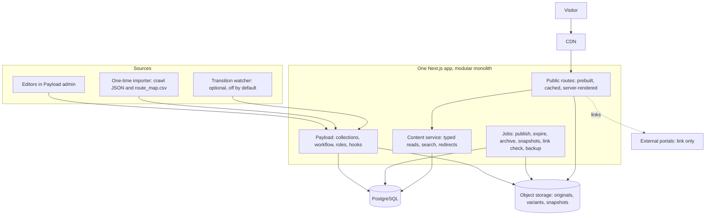
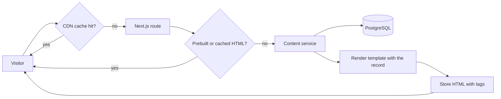
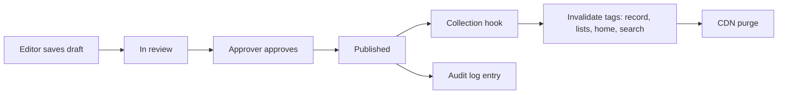
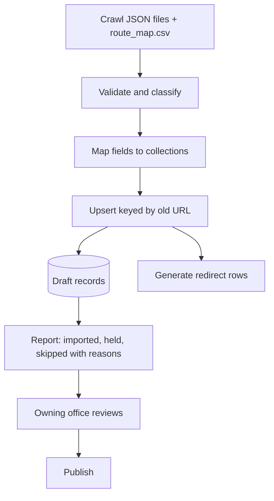
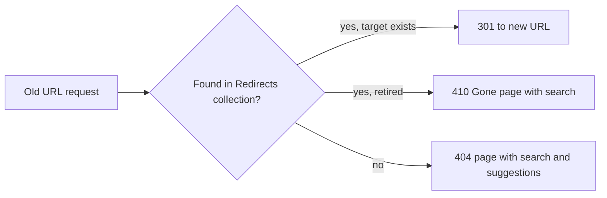
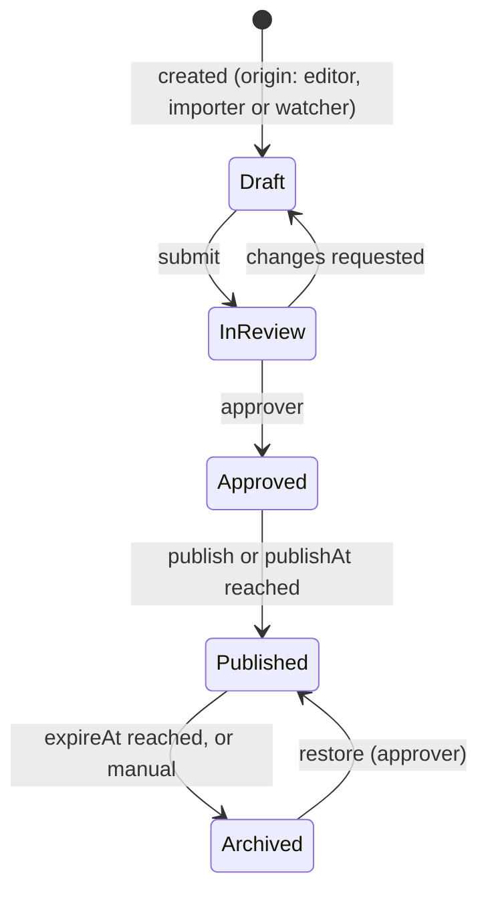

# Addendum to Implementation Plan v2
## Templates, architecture, migration of the crawled content, and the 12 engineering challenges

Date: 6 Nov 2026. This document merges the earlier Addendum A (templates, rendering, migration) and Addendum B (engineering challenges) and replaces both. Read it with `Swat_Website_Implementation_Plan_v2.md`. Where this document and v2 disagree, this document wins; section 17 lists every edit to v2.
Evidence files, all produced from the crawl of uswat.edu.pk on 6 Nov 2026: `uswat_organized/*.json` and `route_map.csv` (1,613 rows).

**Contents:** 0 Coverage and verdicts · 1 What the crawl found · 2 What a modern university site should and should not have · 3 Pages are templates plus records · 4 Content classification · 5 URL design and routes · 6 Architecture · 7 Lifecycle and verification · 8 Importer · 9 Redirect map · 10 Transition watcher · 11 Search · 12 Media · 13 Resilience · 14 Tests · 15 Priorities for 11 days · 16 Risks and open questions · 17 Edits to v2 · 18 New requirements · 19 Verification checklist · Appendix

---

## 0 Coverage and verdicts

### 0.1 Do v2's templates and migration cover the real site?

| Question | v2 today | Verdict |
|---|---|---|
| Are pages produced from templates and data, not hand-built? | Yes in principle: nine templates T1–T9 (5.5), collections (7.2), static-first rendering (7.5) | **Covered at idea level** |
| How do about 1,600 old URLs become new pages? | Not stated. No route table, no old-to-new mapping | **Missing** |
| Which pages are prebuilt and which are rendered on request? | "Static-first with on-demand revalidation", but no rule for what is prebuilt, no page budget, no build-time target | **Partly covered** |
| Request, publish, import and redirect flows | Workflow states and a component table exist; no flow of a request or of an import | **Missing** |
| What the importer reads and how fields map | MIG-01 and ADR-0009 assume an "authorized export" from university IT; no field mapping | **Missing; premise now outdated (we hold the crawl)** |
| Redirect map | MIG-02 requires 100% of old URLs to 301 or 410; no rules or counts | **Partly covered** |
| Content types found on the real site | Collections list has no Affiliated Colleges, Merit Lists or Contact Directory | **Gaps** |
| Handling of empty shells, duplicates, stubs | Not covered | **Missing** |

### 0.2 Verdict on the 12 engineering challenges

The list asks the right questions: can the site maintain itself, is the data trustworthy, does it survive failures. It is a good learning roadmap. As a plan for this project it has three problems: it assumes a separate Python and React stack when v2 chose one TypeScript application, it asks you to build an admin dashboard that Payload already provides, and it treats scraping the old site as a permanent content source. The rest is useful.

| # | Challenge | Already in v2 or in sections 3 to 9 | Verdict | Where handled |
|---|---|---|---|---|
| 1 | Dynamic content, no redeploy | Collections, `status`, `expireAt`, homepage composition and statistics globals (7.2), FR-06 | **Keep, and add** independent homepage modules, a last-good snapshot, and the direct-database-write caveat | 6.2 |
| 2 | Ingestion pipeline | One-time importer (section 8); crawler already exists and resumes | **Adapt.** Continuous scraping is wrong after cutover. Keep the crawler as a one-time tool plus an optional transition watcher | 10 |
| 3 | Verification system | `source`, `verifiedAt`, `reviewDueAt`, `riskClass`, high-impact approval | **Adopt with changes:** verification is a second axis, not a replacement for workflow states; add content hash | 7 |
| 4 | Announcement lifecycle | Five states, scheduled publish and expiry (CMS-07 area), archive | **Adopt:** add origin, reviewer notification, a rule for notices with no expiry | 7 |
| 5 | Search | ADR-0007 only (PostgreSQL full-text plus `pg_trgm`) | **Add the specification**, including the expired-versus-current ranking rule | 11 |
| 6 | Media management | Alt text required, licence and credit fields, generated sizes (CMS-06) | **Add** hash de-duplication, rights status that blocks publishing, dimension rules per slot | 12 |
| 7 | Editorial dashboard | Payload admin, CMS-09 dashboard, six roles | **Do not build.** Configure Payload. Six roles already cover the three requested | 2 |
| 8 | Resilience | NFR-04 (cached pages serve if the database is down) | **Add** per-module failure isolation and fallbacks | 6.2, 13 |
| 9 | Performance | NFR-02: LCP 2.5 s, INP 200 ms, CLS 0.1; TTFB targets | **Keep.** Lighthouse scores are a secondary report; measure on the deployed URL | v2 section 8 |
| 10 | Accessibility | NFR-01 WCAG 2.2 AA, per-component axe and keyboard tests | **Keep** | v2 5.4 |
| 11 | Automated testing | Vitest, Playwright, axe, k6 named | **Add** named user journeys and edge cases | 14 |
| 12 | Deployment and observability | OPS-02, NFR-07, MIG-06, CI | **Keep.** Cut extra environments | v2 sections 8, 9 |

Honest limits of this assessment: I compared the list with v2 as written, not with a running system. Nothing here has been built or measured yet.

---

## 1 What the crawl found (facts that change the plan)

Source: 406 pages saved, 5 dead links (404), about 150 archive listing pages, all within one crawl. Sitemap listed 1,199–1,417 URLs depending on timeouts.

| Finding | Number | Consequence |
|---|---|---|
| Distinct old URLs now classified | **1,613** (1,230 archive posts + 378 crawled pages + 5 dead links) | This is the migration universe |
| Archive posts (news, notices, tenders, jobs, events), 2019–2026 | **1,230** (76% of all URLs) | One Article template; must be rendered on request, not prebuilt |
| Posts that sit in more than one old category | 249 of 1,230 | Need one primary type plus tags |
| Posts whose full body is saved | 28 (titles, links, year and month exist for all 1,230) | Bodies for older posts are a separate, optional import |
| Archive listing pages (`/category/x/page/N`) | 150 | Disappear; replaced by one generated listing per type |
| Merit-list pages | 23 | Merge into one filterable list |
| Departments, institutes, colleges | 40 (8 empty shells, 1 duplicate) | One Department template; hold empty ones as drafts |
| Faculty profiles | 185 across 31 departments | People records shown inside departments and in a directory |
| Programme pages | 31, almost all empty except an embedded PDF | Structured Programme records; PDFs attached |
| Offices and directorates | 23 menu entries, 38 pages | One Office template |
| Affiliated colleges | 30 (20 public, 10 private), 103 programme affiliations | New collection |
| Contact Directory | 38 phone entries in 2 tables | New collection |
| Documents linked | 619 files | One Documents library |
| Pages with raw `[pdf id=…]` codes | 50 | Real PDF links are in each saved `page.html`, not in `page.json`; importer must read them from the HTML |
| Content images with no alt text | 890 of 1,089 | Alt text becomes a required field; imports start as drafts |
| External systems | `cms1.uswat.edu.pk`, `exam.uswat.edu.pk`, `sujris.uswat.edu.pk`, `digitallibrary.edu.pk` | Link-only integrations (already MIG-05) |
| University crest | Found at 1254×1254 px in the image pack | Replaces the "vector crest to be supplied" assumption for the demo |

---

## 2 What a modern university website should and should not have

| Should have | Reason |
|---|---|
| Content in a database, pages from templates (sections 3 to 5) | One change updates every place a record appears |
| Task-first home page: admissions, merit lists, exams, notices, jobs, tenders | These are why most visitors arrive |
| Notices with dates, owners, expiry and an archive | Old deadlines mislead people |
| Search that understands departments, programmes, notices and documents | The old site has about 1,600 URLs and no way to find things |
| Every fact traceable to a source and a verification date | Wrong deadlines and wrong names are the main reputational risk |
| Real, licensed photographs with alt text | The old site has 890 of 1,089 content images without alt text |
| Mobile-first layout, WCAG 2.2 AA, Urdu and right-to-left support | Most visitors use phones; the audience reads Urdu and Pashto |
| Honest empty states ("to be supplied") | Better than invented text |
| Link-out to the existing portals (admissions, exams, journal, library) | Rebuilding them is out of scope |

| Should not have | Reason |
|---|---|
| Statistics nobody can source (the mockup's 10,000+ students and similar) | Fails the "never invent facts" rule |
| Autoplay carousels | WCAG 2.2.2; slows the main image (v2 already decides one static hero) |
| A hand-made page per merit list, notice or programme | The cause of the old site's mess |
| Information that exists only inside a PDF | Publish the text; attach the PDF |
| WhatsApp-quality images as hero or card images | The saved ones are at most 950 px wide |
| A scraper as a permanent dependency of the live site | Two sources of truth; breaks when the old site changes or goes away |
| A separate Python API, a custom admin and a React front end for a one-person competition build | More surface than time (see section 15) |
| Infinite scroll on archives | Breaks back-button and keyboard use; use pagination |
| Pop-ups, chatbots without real content, auto-playing video | Distracting, and unreliable without content |
| Raw SQL edits to live content | Bypasses the cache invalidation and audit log (section 6.2) |

---

## 3 Pages are templates plus records

A page is never written by hand. A page is **one template + one record**. About 1,600 old URLs collapse into **9 templates, about 15 URL patterns and 12 collections**.

| Old site | New site |
|---|---|
| 1,613 URLs, each a hand-made page or post | About 1,480 rendered URLs from 9 templates |
| 150 listing pages created by hand | 5 generated listings with filters, year and search |
| 23 merit-list pages | 1 list with a department filter |
| 31 near-empty programme pages | 31 records rendered by T4 |
| Numbered and underscore duplicates | 301 redirects, one canonical URL |

**Page budget (target numbers for the demo)**

| Class | Count | Rendered |
|---|---|---|
| Home, section landings, campuses, colleges, directory, merit lists, downloads, contact, search, listings | about 40 | Prebuilt |
| Departments (31 with content), faculty groups (4), programmes (31), offices (38) | about 104 | Prebuilt |
| Generic pages (About, VC message, Academic Calendar, policies, etc.) | about 80 | Prebuilt |
| **Prebuilt total** | **about 225–250** | At build time |
| Newest 150 articles | 150 | Prebuilt at build time |
| Remaining archive articles | about 1,080 | **On first request, then cached** |
| Listings, filters, search results | unlimited | Server-rendered and cached by tag |

Build time stays flat as the archive grows, because older articles are not part of the build.

---

## 4 Content classification: old page to collection to template

| Old pages | Count | New collection | Template | Action |
|---|---|---|---|---|
| Home | 1 | Globals: homepage | T1 | Rebuild from mockup |
| News posts (Latest News, Media Cell) | 397 | News | T5 | Migrate |
| Notices (Announcements) | 208 | Notices | T5 | Migrate |
| Events | 183 | Events | T5 | Migrate; past events are archived, not "upcoming" |
| Jobs | 220 | Jobs | T5 | Migrate; expired jobs go to archive |
| Tenders | 222 | Tenders | T5 | Migrate; expired tenders go to archive |
| Category listing pages | 150 | (none) | T6 | Replace with generated listing; 301 |
| Departments, institutes, colleges | 40 | Departments (+ People) | T3 | 31 migrate, 8 hold as draft, 1 redirect to duplicate |
| Programme pages | 31 | Programmes | T4 | Migrate as structured records |
| Offices and directorates | 38 | Offices | T7 / T2 | Migrate |
| Merit-list pages | 23 | MeritLists (inside AdmissionsCycles) | T6 | Merge into one list; 301 |
| Affiliated-college pages | 3 | AffiliatedColleges | T6 | Merge into one listing; 301 |
| Campuses | 3 | Campuses | T2 | Migrate |
| Contact List | 1 | ContactDirectory | T7 | Migrate |
| Downloads and rules | 2 | Documents | T8 | Merge into library |
| Generic pages | 86 | Pages | T2 / T8 | 20 words or more migrate; shorter hold as draft |
| Dead links | 5 | none | none | 410 or redirect to parent |

Exact per-URL rows, with proposed new URL and action, are in **`route_map.csv`** (1,613 rows).

Rules used:
1. A post in several old categories gets one primary type by priority (Tenders, Jobs, Events, Notices, News, Media Cell). The other categories become tags.
2. Pages of 20 words or fewer are never published as pages. Departments of fewer than 40 words are held as drafts. Programme pages stay because their value is the structured record, not the text.
3. Anything held or merged still gets a redirect, so no old link breaks.

---

## 5 URL design and routes

| # | Pattern | Template | Collection | Rendering | Revalidation tag |
|---|---|---|---|---|---|
| 1 | `/` | T1 | Globals | Prebuilt | `home` |
| 2 | `/about/`, `/academics/`, `/research/`, `/campuses/`, `/administration/`, `/admissions/` | T2 | Pages + curated lists | Prebuilt | `section:{name}` |
| 3 | `/academics/faculties/{slug}/` | T3 | Faculties | Prebuilt | `faculty:{id}` |
| 4 | `/academics/departments/{slug}/` | T3 | Departments, People | Prebuilt | `dept:{id}` |
| 5 | `/academics/programmes/` and `/{slug}/` | T6, T4 | Programmes | Prebuilt | `programmes`, `prog:{id}` |
| 6 | `/academics/affiliated-colleges/` | T6 | AffiliatedColleges | Prebuilt | `colleges` |
| 7 | `/administration/{office}/` | T7 / T2 | Offices | Prebuilt | `office:{id}` |
| 8 | `/campuses/{slug}/` | T2 | Campuses | Prebuilt | `campus:{id}` |
| 9 | `/people/` (directory with filters) | T7 | People | Server-rendered, cached | `people` |
| 10 | `/news/`, `/notices/`, `/events/`, `/jobs/`, `/tenders/` | T6 | per type | Server-rendered, cached, paginated | `list:{type}` |
| 11 | `/news/{slug}/`, `/notices/{slug}/` … | T5 | per type | **Newest 150 prebuilt; the rest on first request, then cached** | `item:{type}:{id}` |
| 12 | `/admissions/merit-lists/` | T6 | MeritLists | Prebuilt | `merit` |
| 13 | `/downloads/` | T8 | Documents | Server-rendered, cached | `documents` |
| 14 | `/contact/`, `/contact/directory/` | T9 / T7 | ContactDirectory | Prebuilt | `contact` |
| 15 | `/search/?q=` | T9 | all (PostgreSQL full-text) | Server-rendered, never cached publicly | none |
| 16 | `/{slug}/` | T2 / T8 | Pages | Prebuilt | `page:{id}` |

Decisions:
- **People have no page of their own** in the demo (185 URLs saved). They appear on department pages and in the `/people/` directory. A person page can be added later without changing anything else.
- Article slugs reuse the old slug (the last part of `/2026/11/slug/`), so redirects are mechanical.
- Listings use query parameters for filters (`?year=2025&page=2`); the filter set is whitelisted so crawlers cannot create endless URLs.

---

## 6 Architecture

### 6.1 Overall picture

The key idea is a clear separation between where content comes from, where it lives, and how each part of a page is served. Sections 6.2 to 6.4 give the module rules, the rendering rules and the flows.

### 6.2 Homepage modules are independent

Each part of the home page reads its own slice, with its own cache tag, its own timeout and its own failure behaviour. An outage or error in one module never blanks the page.

| Module | Source | Cache tag | Timeout | If it fails | Safety-net refresh |
|---|---|---|---|---|---|
| Header, footer, utility bar | Globals | `chrome` | 1 s | Last-good snapshot | 15 min |
| Hero | Globals: homepage | `home:hero` | 1 s | Last-good snapshot | 15 min |
| Statistics | Globals: statistics (each with value, source, `verifiedAt`) | `home:stats` | 1 s | Hide module, reserved height | 15 min |
| Admissions banner | AdmissionsCycles, current | `home:admissions` | 1.5 s | Last-good snapshot, else hide | 5 min |
| Leadership message | Globals / Pages | `home:leader` | 1 s | Last-good snapshot | 15 min |
| Portals and services | Globals: links | `home:portals` | 1 s | Last-good snapshot | 15 min |
| Notices, jobs, tenders | Collections, newest valid | `list:notices` and similar | 1.5 s | Last-good snapshot, else hide | 5 min |
| News and events | Collections | `list:news`, `list:events` | 1.5 s | Last-good snapshot, else hide | 5 min |

**Rules**
1. **Last-good snapshot.** When a record publishes, a job writes a small JSON snapshot per module to object storage. If the database or the CMS fails, the module renders from its snapshot. This extends NFR-04 from "cached pages" to "cached modules".
2. **Writes go through the CMS only.** Publishing triggers tag invalidation. A direct SQL edit does not, so the home page would stay stale. Direct database writes are unsupported and documented as such. The safety-net refresh in the table bounds the damage, and the admin has a purge button for Platform Admins.
3. **Reserved space.** A hidden or failed module keeps its height or collapses without shifting the content below it (CLS under 0.1).
4. **No module calls an external portal while rendering.** Portals are links only (MIG-05).

### 6.3 Rendering modes and rules

**Three rendering modes**

| Mode | Used for | Behaviour |
|---|---|---|
| Prebuilt | About 250 stable pages plus newest 150 articles | HTML generated at build, served from CDN |
| On first request, then cached | Older archive articles | Rendered once from the database, stored with a tag, served from cache afterwards |
| Server-rendered and cached by tag | Listings, directory, downloads | Always built from current data, cached until its tag is invalidated |

**Rules**
1. Publishing a record invalidates only the tags in section 5 that depend on it: its own page, the lists that include it, the home page if it appears there, and the search index entry.
2. If the database is down, cached pages keep serving (NFR-04). Pages not yet cached show a clear "temporarily unavailable" page with a link to search and the contact page.
3. A build never fails because of content: records that fail validation are skipped and logged, not fatal.
4. The exact Next.js APIs for the static list and tag invalidation are confirmed in spike S-1; this document fixes the behaviour, not the function names.

### 6.4 Flows

**Visitor request**

**Editor publishes**

**Migration import**

**Old URL arrives**

---

## 7 Lifecycle and verification

Two separate axes, because "is it approved to show" and "is it still true" are different questions. v2's five workflow states stay unchanged.

| Axis | Values | Who moves it |
|---|---|---|
| **Status** (v2) | Draft → In review → Approved → Published → Archived | Role-gated, as in v2 section 7.3 |
| **Verification** (new) | Unverified → Verified → Stale | Reviewer verifies; the system marks Stale |
| **Origin** (new, fixed at creation) | `editor`, `importer`, `watcher` | Never changes |

**Rules**
- **VER-rule:** an `importer` or `watcher` record is created as Draft and Unverified. It cannot reach Published without a human Verified action, and a high-impact record (admission dates, fees, leadership names, legal pages) additionally needs an Approver.
- A Published record becomes **Stale** when `reviewDueAt` passes, or when the watcher sees that its source page changed (content hash differs). Stale content stays visible but appears in the review queue and in the stale-content report.
- **Expiry by type:** Jobs, Tenders, Events and Admissions cycles **require** `expireAt` (validation rejects the record otherwise). Notices without `expireAt` leave current listings automatically after 90 days unless an Approver pins them. News does not expire; it leaves the home page when newer items replace it. Archived records stay in the archive listing and in search with the archive filter.
- **Notification:** a new Draft from `importer` or `watcher` appears in the reviewer queue and triggers a notification through an adapter (email or webhook; console output in the demo).
- **Fields added to the governance group (v2 section 7.2):** `origin`, `verificationStatus`, `contentHash` (hash of normalized body), `sourceContentHash` (hash of the source page at collection), `collectedAt`, `pinned`. Existing fields map as follows: `source` is the challenge's `source_url`, `verifiedAt` is `last_verified_at`, and `editor_approved` is derived from the workflow state.

| Requirement | Acceptance | Class |
|---|---|---|
| VER-01 No unverified record is ever shown as official | A record with `verificationStatus = unverified` cannot be Published; a test tries and fails | C |
| VER-02 Source change marks content Stale | Changing a watched source in a test fixture moves the record to Stale and queues it | P |
| LIF-01 Expiry moves records out of current listings | A job at `expireAt` archives the record; it leaves home and current lists and stays in the archive | C |
| LIF-02 No-expiry notices age out | A notice with no `expireAt` leaves current lists after 90 days unless pinned | C |
| LIF-03 New drafts notify reviewers | Importer or watcher draft creates a queue entry and one notification | C |
| LIF-04 Jobs, Tenders, Events and Admissions require an expiry | Saving without `expireAt` is rejected | C |

---

## 8 Importer specification (replaces the "authorized export" wording in MIG-01)

**Inputs** (read-only, versioned in `/scripts/import/data/`)
`departments.json`, `faculty.json`, `programs.json`, `offices.json`, `campuses.json`, `affiliated_colleges.json`, `contact_directory.json`, `notices.json`, `news_posts.json`, `documents.json`, `contacts.json`, `site_structure.json`, `home.json`, `design.json`, `route_map.csv`, plus each page's saved `page.html` for embedded PDF links.

**Field mapping**

| Collection | Key (idempotency) | Fields filled from the crawl | Fields a human must supply |
|---|---|---|---|
| Faculties | old menu label | name, member departments | owner office |
| Departments | old URL | name, faculty group, summary, sections (vision, mission, programmes), documents, emails | verified owner, head of department |
| People | email, else name + department | name, designation, details, email | photo, CV link, publications |
| Programmes | old URL | name, campus, department (keyword mapped), embedded curriculum PDF | level, duration, eligibility, fee link |
| Offices | old URL | name, group, text, emails, phones, documents | head of office, hours |
| AffiliatedColleges | sector + number | name, programmes, affiliation year | address, link |
| ContactDirectory | section + name | name, phone | email, hours |
| News, Notices, Events, Jobs, Tenders | old URL | title, year and month, categories as tags, excerpt, body and images where crawled | exact publish date, closing date (jobs, tenders), owner office |
| Documents | file URL | title, source page, file type | category, version, effective date |
| MeritLists | old URL | title, embedded PDFs | admission cycle, programme |

**Rules**
1. Every imported record is created as **Draft** with `origin = importer`, `verificationStatus = unverified`, `source` = old URL and `collectedAt` = crawl date (6 Nov 2026). Nothing publishes itself, and it can only reach Published after a human Verified action (section 7).
2. High-impact classes (leadership names, admission dates, fees) are never auto-published, even from a clean record.
3. A record that is missing a required field is skipped with a reason; the importer never invents values.
4. Image `alt` is required to publish. Imported images start with empty alt and appear in a "needs alt text" queue.
5. Idempotent: a second run changes nothing; counts must match.
6. A `--dry-run` mode prints the report without writing.

**Expected report (predictions to test)**

| Outcome | Expected count | Reason |
|---|---|---|
| Imported as draft | about 1,560 | Articles, departments, programmes, offices, pages |
| Held as draft, not importable as pages | about 33 | Empty shells (8 departments, near-empty pages) |
| Redirect only | about 4 | Duplicate department and numbered duplicates after review |
| Skipped | 5 | Dead links |
| Skip rate | about 2–3% | v2 predicted at least 10%; the crawl output is cleaner than a raw database export, so expect far fewer skips |

**Archive bodies.** Only 28 articles have a saved body. For the demo, import bodies for the newest 150 articles and mark the remaining ones `bodyStatus = "stub"` (title, year, month, categories, excerpt). Stub articles show their title and a note instead of fake text. The remaining bodies come from re-running the crawler with a higher `--max-news`.

---

## 9 Redirect map

| Old pattern | Count (approx.) | Rule |
|---|---|---|
| `/{yyyy}/{mm}/{slug}/` | 1,230 | `301` to `/{type}/{slug}/` |
| `/category/{cat}/` and `/page/{n}/` | 150 | `301` to the listing for that type; page number kept as `?page=` |
| `/department_of_x/` (underscores) | by rule | Underscores replaced by hyphens, then match |
| `/uos/…` duplicate prefix | by rule | Prefix removed, then match |
| Merit-list pages | 23 | `301` to `/admissions/merit-lists/` |
| Affiliated-college pages | 3 | `301` to `/academics/affiliated-colleges/` |
| Held and duplicate pages | about 34 | `301` to the nearest parent (department, section) |
| Dead links | 5 | `410` |
| `/?p={id}` short links | unknown | Resolve only if the old numeric ID is in the export; otherwise `404` with search |

Acceptance tests: every row in `route_map.csv` returns 301 or 410; zero redirect chains longer than one hop; zero loops; the sitemap lists no redirected URL.

---

## 10 Transition watcher (optional, off by default)

**Purpose.** Until the new site replaces the old one, keep the demo's content current by noticing new posts on the old site. It does not replace editors and it ends at cutover.

**Design**
- Reuses the existing crawler in list-only mode: request page 1 of the five category listings (five requests), compare post URLs with known old URLs, and fetch only the new ones.
- Creates Drafts with `origin = watcher`, `verificationStatus = unverified`. It never publishes.
- Idempotent: key is the old URL; running it five times creates each draft once. A changed `contentHash` on an existing source marks the record Stale and attaches the new text for a reviewer to compare.
- Politeness: respects `robots.txt`, at most once per hour, at least one second between requests, identifies itself in the user agent, and stops after cutover through a feature flag.
- Requires written permission from the Chairman DCST (section 16).

**Not recommended:** a continuous full re-crawl, a Python service running beside the live site, or any path where scraped text reaches visitors without review.

| Requirement | Acceptance | Class |
|---|---|---|
| WTC-01 Idempotent | Running the watcher five times on the same fixture creates no duplicate drafts | P |
| WTC-02 Draft only | No watcher record is ever Published automatically | P |
| WTC-03 Stops at cutover | Setting the flag off stops all requests to the old site | P |

---

## 11 Search specification

PostgreSQL full-text search with `pg_trgm` (ADR-0007). No Elasticsearch, no vector database in the first version.

**Indexed types:** Departments, Programmes, Offices, People, Campuses, AffiliatedColleges, Pages, News, Notices, Events, Jobs, Tenders, Documents, ContactDirectory.

**Fields and weights:** title (highest), summary, body (lowest), tags and aliases (for example "CS" for Computer Science).

**Features:** type and year filters, department filter, 10 results per page with pagination, suggestions from titles of departments, programmes and offices, typo tolerance through trigram similarity, and a "did you mean" fallback.

**Ranking rule.** `score = text relevance × type boost × freshness factor`.

| Record state | Freshness factor | Shown by default |
|---|---|---|
| Published, current | 1.0 | Yes |
| Published, no expiry concept (departments, offices, pages) | 1.0 | Yes |
| Expired Jobs, Tenders, Admissions cycles | 0.25 | **No**; only with the archive filter |
| Archived | 0.25 | Only with the archive filter |

Ties break by publish date, newest first. **An expired item can never outrank a current item that matches the query.**

**Acceptance (v2 ADR-0007 gate: relevance set and p95 latency)**
- A fixed set of 20 test queries (for example "computer science", "admission", "merit list", "academic calendar", "tender", "faculty email", "hostel") with expected top results recorded in `docs/search-relevance.md`.
- A test fixture with one current and one expired admission notice, where the expired title matches better: the current one ranks first.
- p95 search latency at most 500 ms on the deployed demo.

| Requirement | Acceptance | Class |
|---|---|---|
| SRC-01 Expired never outranks current | The fixture above passes | C |
| SRC-02 Filters and pagination | Type, year and page parameters return correct subsets; unknown parameters ignored | C |
| SRC-03 Suggestions | Typing "comp" suggests Computer Science departments and programmes | P |
| SRC-04 Latency | p95 at most 500 ms | C |

---

## 12 Media pipeline

**Record fields (added to Media):** `sha256`, `width`, `height`, `format`, `bytes`, `sourceUrl`, `sourcePage`, `altText`, `credit`, `rightsStatus`, `focalPoint`, `variants[]`.

**Pipeline at upload or import:** hash and de-duplicate → read dimensions and format → generate fixed-width variants (400, 800, 1200 and 1600 px) in WebP, with AVIF only if time remains → store the original and the variants → record source URL and page → apply the rights gate.

**Rights gate**

| `rightsStatus` | May be published? |
|---|---|
| `owned`, `permission_granted`, `licensed` | Yes |
| `permission_pending` | Only in the competition demo, with a visible "sample image" mark, and never as a leadership portrait without recorded consent |
| `unknown` | No |

**Quality gates by slot**

| Slot | Minimum width | Alt text |
|---|---|---|
| Hero | 1600 px | Required |
| News card | 800 px | Required |
| Leadership portrait | 600 px | Required; consent recorded |
| Crest | 1000 px or vector | Required |

**Findings from the crawl that this addresses:** 890 of 1,089 content images have no alt text; the home slider images are WhatsApp photos at 950×600 px, so they pass the card slot but fail the hero slot; the crest was found at 1254×1254 px in the image pack; duplicates across 406 pages are likely because the same header and footer images repeat, and de-duplication by hash prevents storing them hundreds of times.

| Requirement | Acceptance | Class |
|---|---|---|
| MED-01 Duplicate upload is detected | Uploading the same file twice stores one original | C |
| MED-02 Variants exist | Each image has the four widths in WebP | C |
| MED-03 Rights gate | A record with `unknown` rights cannot be Published | C |
| MED-04 Slot minimums | A 950 px image cannot be placed in the hero | C |
| MED-05 Source tracked | Every imported image keeps `sourceUrl` and `sourcePage` | C |

---

## 13 Resilience matrix

| Failure | Behaviour | Test |
|---|---|---|
| Database or CMS down | Cached pages and module snapshots serve; forms and admin show a maintenance message; alert logged | Stop the database in CI; the home page still returns 200 with all modules |
| A module is slow | After its timeout, render the last-good snapshot, else hide it without layout shift | Delay one module by 3 s; the page stays under budget |
| Image returns 404 | Fallback image for that type; the failure goes to the broken-media report | Point a record at a missing file |
| Notice has no expiry | Ages out after 90 days unless pinned; Jobs, Tenders and Admissions cannot be saved without expiry | Save one without `expireAt` |
| Department is incomplete | Render only the fields present; no placeholder prose; empty sections are hidden | Render a record with only a name |
| Unexpected CMS response | Schema check (Zod) fails; the record is skipped and logged; the rest of the page renders | Feed a malformed record |
| External portal offline | Links only; nothing in the render path calls the portal | Block the portal host; pages are unaffected |
| Search backend slow or failing | Search page shows an error with browse links | Force a timeout |

| Requirement | Acceptance | Class |
|---|---|---|
| RES-01 Module isolation | One failing module never causes a 5xx on `/` | C |
| RES-02 Snapshot fallback | With the database stopped, `/` renders every module from snapshots | C |
| RES-03 Fallback images | A 404 image shows a typed fallback and appears in the report | C |
| RES-04 Validation at boundaries | Malformed records are skipped with a log entry, never crash a page | C |
| RES-05 Timeouts | Every external or database read has a timeout and one retry where safe | C |

---

## 14 Test additions

**Critical journeys (Playwright, English and Urdu)**

| ID | Journey |
|---|---|
| J1 | Student opens the home page → Admissions → current admission notice → admissions portal link |
| J2 | Applicant opens Merit lists → filters by department → opens a list |
| J3 | Job seeker opens Jobs → finds a current job; an expired job appears only under archive |
| J4 | Parent finds a department → programme → contact |
| J5 | Editor publishes a notice → it appears on the home page and in search within one minute |
| J6 | An expiry job runs → the item leaves the home page and stays in the archive |
| J7 | Search "admission" → the current admission item ranks first |
| J8 | Database stopped → home page still renders |

**Edge cases:** expired admission notice, missing prospectus PDF, invalid or missing image, duplicate announcement import, source page changed (Stale), malformed CMS record, very long listing pagination, right-to-left layout of every template.

**Layers:** Vitest for validators, lifecycle transitions, the ranking function and slug and redirect logic; integration tests against a real PostgreSQL container for importer idempotency and search ranking; Playwright with axe for journeys and accessibility; k6 scenario S1 only for the demo. If the crawler stays in Python, add a small pytest file for its URL normalization and classification helpers; otherwise skip pytest.

| Requirement | Acceptance | Class |
|---|---|---|
| TST-01 Journeys J1 to J8 pass in CI | All eight green | C |
| TST-02 Edge cases covered | Each listed edge case has a named test | C |
| TST-03 Importer idempotency | Second run gives identical counts | C |

---

## 15 What to do in 11 days (priorities)

| Priority | Items |
|---|---|
| **Must** | Templates T1 to T9 rendering from records, with the page budget and route table (sections 3 to 5); the importer with dry run and report (section 8); the redirect map (MIG-08, section 9); homepage modules with independent cache tags and snapshots (section 6.2); status plus verification fields and the VER-01 gate; scheduled expiry and archive (LIF-01, LIF-04); basic search with the expired-demotion rule (SRC-01, SRC-02); module isolation and snapshot fallback (RES-01, RES-02); accessibility baseline; journeys J1, J3, J5, J6, J7, J8; deployment, backup and logs from v2 |
| **Should** | Media hash de-duplication, rights gate and WebP variants (MED-01 to MED-04); reviewer notifications through a console adapter; the remaining journeys |
| **Cut to the roadmap** | The transition watcher, AVIF, search suggestions beyond titles, extra environments, the Python service as a runtime component, a custom admin dashboard, any search engine beyond PostgreSQL |

If time is short, cut from the bottom of the Should list first. The Must list is what makes the claim "the site maintains itself" true in a demo.

---

## 16 Risks and open questions

| Risk | Effect | Mitigation |
|---|---|---|
| Permission is verbal only | The crawl-as-export premise is weak | Written email from the Chairman DCST before submission; it should also cover the optional transition watcher (section 10) |
| Only 28 article bodies exist | News archive looks thin | Show newest 150 with bodies; mark the rest as stubs; do not invent text |
| Programme and merit pages hold only PDFs | Templates look empty | Show structured fields and the PDF; flag missing eligibility and fee as "to be supplied" |
| Department count conflict (27 on the About page, 28 in the menu) | Wrong number on the site | Show the count from the database, not typed text |
| Old slug collisions across post types | Two posts with the same slug | Slug uniqueness per type; add the year on collision |
| Leadership change | Names go stale | Leadership is high-impact, approver-only, with a review date |

Open questions for the Chairman DCST: written crawl and watcher permission; whether the WordPress, PHP and MySQL stack is mandatory (v2 open item 1 remains the top blocker); the judging criteria; and whether a high-resolution crest and licensed campus photographs can be supplied.

---

## 17 Edits to v2

| v2 location | Change |
|---|---|
| 0 and 1, ADR index | **ADR-0009 revised:** "Content import via an authorized crawl, with written permission from the Chairman DCST." The crawl obeyed robots.txt and succeeded, so the premise that the robots file blocks automated reading is withdrawn. Get the permission in writing. |
| ADR-0007 | Attach the ranking rule and the 20-query relevance set from section 11. |
| 3 CMS features | Mark "Review queue" and "Editor dashboard" as configured in Payload, not built. |
| 4 Real-data register | Replace the `[BLOCKED]` rows for menu, departments, offices, tagline and address with the crawl data, evidence label `[OFFICIAL]` with source URL. Vice Chancellor is **Prof. Dr. Husnul Amin** (home page, VC Office page, VC message, announcements). Dr. Muhammad Qasim appears as Pro Vice Chancellor. The statement that the mockup name is wrong is withdrawn. |
| 5.5 Templates | T5 is used for all five post types; T6 has two sub-layouts (card list and table list); People have no page template in the demo. |
| 6 Requirements | Add the requirements in section 18. |
| 7.2 Governance fields | Add `origin`, `verificationStatus`, `contentHash`, `sourceContentHash`, `collectedAt`, `pinned`. |
| 7.2 Collections | **Add** AffiliatedColleges, MeritLists, ContactDirectory, ArticleTags. **Rename** "Faculties" to "Faculty groups" in editor-facing text to avoid confusion with faculty members. Add `bodyStatus` (`full`, `stub`) to the five post collections. |
| 7.2 Globals | Statistics and homepage modules follow the module table in section 6.2. |
| 7.5 Rendering | Replace item 1 with the three-mode table in section 6.3. Add the last-good snapshot rule and the safety-net refresh intervals (section 6.2). State that direct database writes are unsupported. |
| 7.6 Repository | Add `/scripts/import/data/` for the crawl files and `/scripts/import/route_map.csv`. |
| 11 P3 | Add the verification axis, expiry validation and the notification adapter (section 7). |
| 11 P4 | Replace "convert the register into seed files" with: build the importer against the files in section 8; run it dry; review the report; publish selected records. Add gate **G4b**: importer run twice gives identical counts, and the report matches the predictions within 20%. |
| 11 P5 | Build T1 to T9 once; check every department, programme and office page from the same template, not one by one. Add gate **G5b**: the first 150 articles prebuild; an older article renders on first request and is served from cache on the second. Add module isolation tests and journeys J1, J3, J5 to J8 (section 14). |
| 11 P6 | Add the search relevance set and the resilience tests (sections 11 and 13). |

---

## 18 New requirements

| ID | Requirement | Acceptance | Class |
|---|---|---|---|
| RND-01 | Page budget is met | Build output lists 225 to 400 prebuilt pages | C |
| RND-02 | Build time does not grow with the archive | Build stays under 5 minutes with 1,230 and with 5,000 article records | C |
| RND-03 | Older article renders on request and is cached | First request under 1.5 s uncached; second under 800 ms | C |
| RND-04 | Publishing invalidates only affected tags | Publishing one notice changes its page, its list and the home page, nothing else | C |
| RND-05 | Filter URLs are whitelisted | Unknown query parameters are ignored; no unbounded URL space | C |
| MIG-08 | Route map is complete | Every `route_map.csv` row resolves (301, 410 or 200) | C |
| MIG-09 | Held and stub records never show fake text | A stub article shows only real fields; held pages return their redirect | C |
| MIG-10 | Imported images need alt text | No published record has an image without alt text | C |
| HOM-01 | Each homepage module has its own tag, timeout and fallback | A failure test per module leaves `/` at 200 with the other modules intact | C |

The other new requirements are defined where they apply: VER-01, VER-02, LIF-01 to LIF-04 (section 7); WTC-01 to WTC-03 (section 10); SRC-01 to SRC-04 (section 11); MED-01 to MED-05 (section 12); RES-01 to RES-05 (section 13); TST-01 to TST-03 (section 14).

---

## 19 Verification checklist (numbers to match before any claim of completeness)

| Check | Expected |
|---|---|
| `route_map.csv` rows | 1,613 |
| Articles by type | News 397, Tenders 222, Jobs 220, Notices 208, Events 183 |
| Departments with content / held | 31 / 8 (plus 1 duplicate redirect) |
| Programmes | 31 |
| Offices | 38 pages (23 menu entries) |
| Affiliated colleges | 30, with 103 programme affiliations |
| Contact directory entries | 38 |
| Documents | 619 |
| Faculty profiles | 185 across 31 departments |

---

## Appendix: crawler and data pack

- Page HTML is already saved per page by the crawler, so embedded PDF links can be recovered without re-crawling.
- To import older article bodies, re-run `python uswat_crawler.py --max-news 300` (or more). It resumes and skips what exists.
